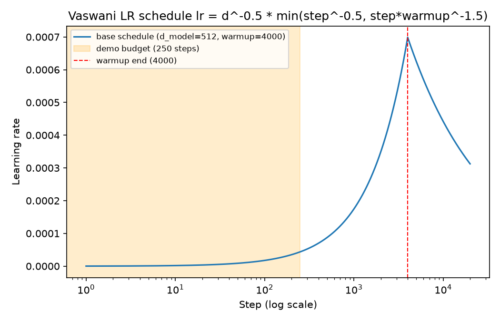
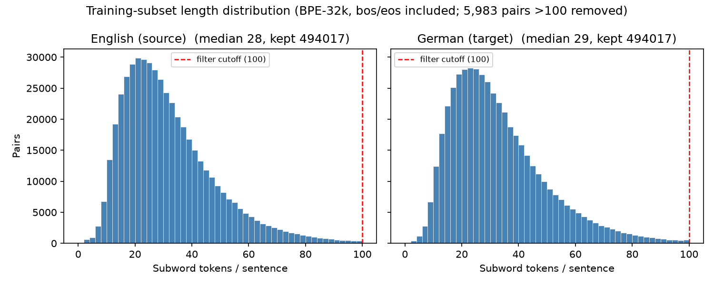
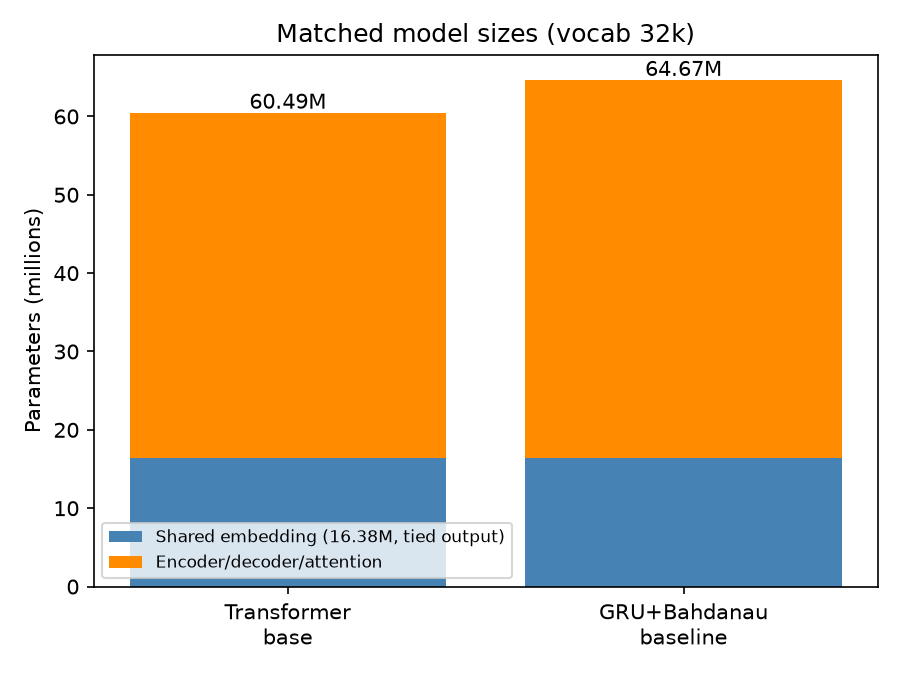
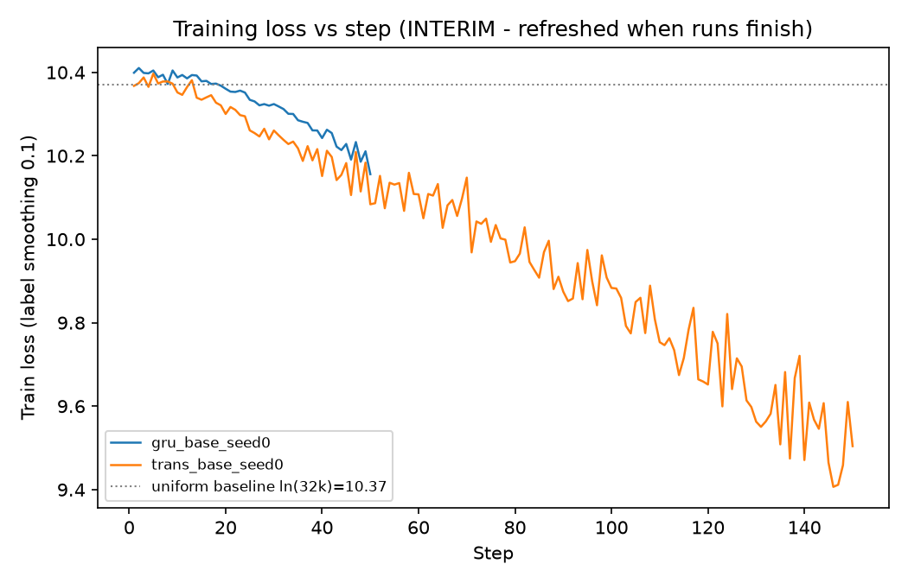
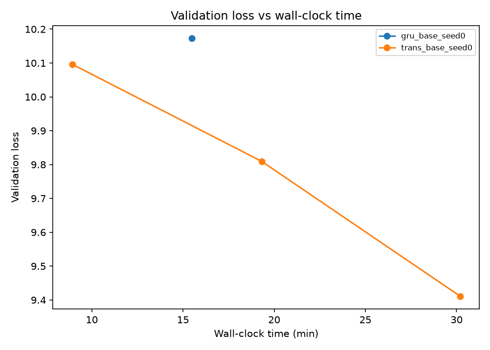

# Reproducing "Attention Is All You Need" (Vaswani et al., 2017)

## Hypothesis

A Transformer with **no recurrence and no convolution** — modeling all dependencies
with multi-head self-attention and sinusoidal position codes alone — **matches or beats
a comparable RNN seq2seq baseline on English→German translation while training faster**
(higher tokens/sec, less wall-clock time to a fixed validation loss).

## What is in this repo

- `src/model_transformer.py` — attention, multi-head attention, Post-LN encoder/decoder
  blocks written from scratch (no `nn.Transformer`). `F.scaled_dot_product_attention`
  is used only after verifying it matches a naive implementation to within 1e-5
  (`scripts/verify_sdpa.py`).
- `src/model_rnn.py` — GRU encoder-decoder with Bahdanau (additive) attention baseline,
  sized to a similar parameter count.
- `src/data.py`, `scripts/prepare_data.py` — WMT14 En-De subset sampling (fixed seed,
  indices saved), shared SentencePiece BPE-32k trained on the training subset only,
  >100-token filtering, length-bucketed batching.
- `src/train.py` — Adam (β1=0.9, β2=0.98, ε=1e-9), Vaswani LR schedule (warmup 4000),
  label smoothing 0.1, token-budget batching, checkpoint averaging over last 5 saves,
  tokens/sec + wall-clock + peak-RSS logging.
- `src/decode.py` — beam search (beam 4, length penalty α=0.6).
- `configs/` — paper-faithful target config plus the actually-executed CPU-demo configs.
- `results/` — raw logs, per-run BLEU, plots.

## Setup

```bash
python3 -m venv /tmp/opencode/venv
/tmp/opencode/venv/bin/pip install -r requirements.txt
/tmp/opencode/venv/bin/python scripts/verify_sdpa.py
/tmp/opencode/venv/bin/python scripts/prepare_data.py --data-dir data --n-sub 500000 --seed 1234
```

## Data

- Source: Hugging Face `wmt/wmt14`, config `de-en` (4,508,785 train pairs).
  `validation` (3000) is newstest2013, `test` (3003) is newstest2014.
- Training subset: 500,000 pairs sampled with seed 1234 → `data/subset_indices_seed1234.npy`
  (+ `subset_meta.json`). After >100-subword filtering: **494,017** kept (5,983 removed).
- Tokenizer: shared BPE-32k SentencePiece trained on the training subset only
  (`data/spm32k_seed1234.model`/`.vocab`), `unk=0 bos=1 eos=2 pad=3`, byte fallback on.
- Batching: sort-by-length buckets, ~2048 subword tokens per micro-batch (demo; see deviations).

## Model (base, paper-faithful)

- 6 encoder + 6 decoder layers, d_model=512, 8 heads (d_k=64), d_ff=2048, dropout 0.1.
- Sinusoidal positional encoding; **Post-LayerNorm** exactly as in the paper
  (residual + dropout → LayerNorm). Note: Pre-LN is more common today because it is
  easier to optimize, but we keep Post-LN for fidelity.
- One shared source/target embedding table; output projection tied to it.
- GRU baseline: 4-layer bidirectional encoder (hidden 768/dir) + 4-layer decoder
  (hidden 512) + Bahdanau attention (512) + same shared/tied embeddings.
  Parameter counts (vocab 32k): **Transformer 60.49M, GRU 64.67M**.

## Training (executed budgets)

- Optimizer/loss/schedule exactly as §3: Adam β=(0.9, 0.98), ε=1e-9;
  `lr = d_model^-0.5 · min(step^-0.5, step·warmup^-1.5)`, warmup=4000; label smoothing 0.1.
- Mixed precision: fp32 on CPU (bf16 autocast available in code via `amp: true`, not used
  for the demo runs; throughput reported as tokens/sec regardless).
- Main comparison: 250 optimizer steps each, matched token budget, seed 0.
- Ablations: 100 steps, 2 seeds per configuration; heads=8 reuses the sinusoidal runs.
- Last-5-checkpoint averaging for every run; `target_val_loss` 9.0 (mains) / 9.5 (ablations).

## Evaluation

- Beam search, beam 4, length penalty α=0.6; generation capped at
  `min(128, src_len+30, 64)` subwords (CPU safeguard, documented here).
- `sacrebleu.corpus_bleu` on detokenized output; per-run `results/bleu/<run>.txt`
  records BLEU + sacrebleu format/signature string + N.
- N used: **first 150 test sentences for mains, first 50 for ablations** (see deviations).

## Exact deviations from the paper

| Item | Paper | This reproduction |
|---|---|---|
| Data | full WMT14 (~4.5M) + back-translated? (En-De 27.3 BLEU setup) | 500k subset (494k after filtering), seed 1234 |
| Tokenizer | wordpiece-ish 32k (paper: 32k shared? actually 37k) | shared SentencePiece BPE-32k trained on subset only |
| Batch | ~25k src + 25k tgt tokens/step, 100k steps, 8×P100 | ~2048 tokens/step, 250 steps mains / 100 ablations, CPU-only |
| Warmup/LR | warmup 4000 over 100k steps | same formula/warmup (kept for fidelity) → demo LR stays small; disclosed |
| Decoding | beam 4, α=0.6, full newstest2014 (3003) | beam 4, α=0.6, but first 150 (mains) / 50 (ablations); gen-length cap |
| Checkpoints | avg last 5 / 20 | avg last 5 saves |
| Absolute BLEU | 27.3 (base) | expected ≪ paper (reduced budget); judge by relative comparisons |

## Results

> **Status: training in progress.** Values below are interim snapshots; the table and
> plots are refreshed when all runs finish. Final numbers go in `analysis.md`.

| Run | Params | Step | Train time | tok/s | Train loss | Val loss | Test BLEU (N) |
|---|---|---|---|---|---|---|---|
| trans_base_seed0 | 60.49M | 150/250 | ~30 min | ~66 | 9.50 | 9.41 | pending (N=150) |
| gru_base_seed0 | 64.67M | 50/250 | ~15 min | ~43 | 10.16 | 10.17 | pending (N=150) |

Ablations (mean ± std, 2 seeds): see `results/plots/bleu_vs_posenc.png`,
`results/plots/bleu_vs_heads.png`, and `analysis.md`.

## Visualizations

All figures live in `results/plots/` and are regenerated by
`scripts/make_figures.py` (static/data figures) and `scripts/plot_results.py`
(comparison figures, refreshed as runs finish).

**Learning-rate schedule.** The paper's exact schedule is kept (warmup 4000);
the 250-step CPU demo only reaches LR ≈ 4.4e-5 (vs ≈ 7e-4 at warmup end),
which is why absolute progress is slow — disclosed, not tuned around.



**Data.** Length distribution of the 500k training subset after BPE-32k
encoding (5,983 pairs over 100 subword tokens removed, 494,017 kept).



**Matched model sizes.** Both models share the same 16.38M embedding table
(with tied output projection); the GRU baseline is sized to parity.



**Training loss vs step (interim).** The Transformer is already below the GRU
at matched steps; the GRU point sits above the Transformer curve.



**Validation loss vs wall-clock time (interim).** The key speed comparison:
at ~15 min wall-clock the Transformer is already ~0.3 loss below the GRU.



**Ablations (pending).** BLEU-vs-positional-encoding and BLEU-vs-heads plots
(`bleu_vs_posenc.png`, `bleu_vs_heads.png`) appear here once the 10 ablation
runs finish.

## Reproduce

```bash
# SDPA check + data (once)
TORCH_THREADS=9 /tmp/opencode/venv/bin/python scripts/verify_sdpa.py
# mains (run in parallel on a multicore CPU)
/tmp/opencode/venv/bin/python scripts/run_one.py --config configs/demo_transformer.yaml --run-name trans_base_seed0 --test-n 150
/tmp/opencode/venv/bin/python scripts/run_one.py --config configs/demo_gru.yaml --run-name gru_base_seed0 --test-n 150
# ablations (10 runs)
/tmp/opencode/venv/bin/bash scripts/run_ablations.sh 50
/tmp/opencode/venv/bin/python scripts/plot_results.py
```

## Files not run / limitations

- Full newstest2014 (3003) decoding per run (~25 s/sentence beam-4 on CPU → ~20 h per
  3000-sentence run) was infeasible; used first 150/50 with the cap above.
- Paper-scale training (100k steps × 25k tokens, GPUs) was infeasible on this CPU-only
  machine (no CUDA); relative time-to-loss + throughput are the speed evidence.
